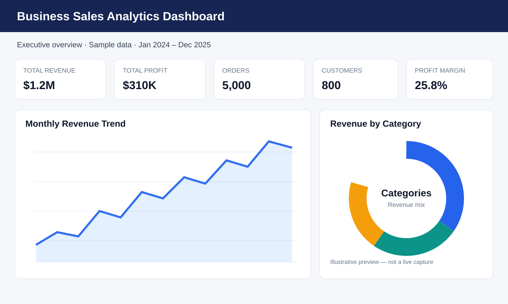
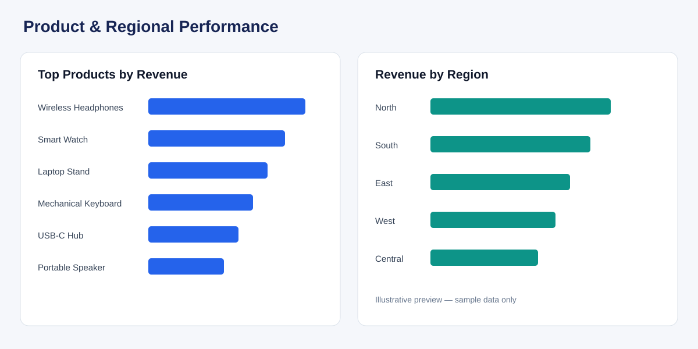

# Business Sales Analytics Dashboard

End-to-end portfolio project for **Data Analyst and Business Analyst** roles using SQL, Excel, Power BI and an interactive Streamlit dashboard.



## Business questions
- How are revenue and profit changing month by month?
- Which products and categories generate the most revenue?
- Which regions and sales channels perform best?
- How many unique and repeat customers are purchasing?
- What are average order value, profit margin and revenue per customer?

## Features
- Interactive date, region, category and sales-channel filters.
- KPI cards for revenue, profit, orders, unique customers and profit margin.
- Monthly revenue trend, category mix, top products and regional comparison.
- Customer trends, repeat-customer rate, AOV and filtered CSV export.
- SQLite schema, loader and six business SQL queries.
- Excel workbook generator with raw data and summary worksheets.
- Power BI implementation guide and DAX measures.
- Automated tests and GitHub Actions CI.

## Dataset
5,000 synthetic order records spanning Jan 2024–Dec 2025, 12 products, five regions, three channels and three customer segments. Data is generated for demonstration, not from a real company. Currency is illustrative USD.

## Run locally
Requires Python 3.10+.

```bash
git clone https://github.com/strawhat0605/business-sales-analytics-dashboard.git
cd business-sales-analytics-dashboard
python -m venv .venv
# macOS/Linux
source .venv/bin/activate
# Windows PowerShell
.venv\\Scripts\\Activate.ps1
pip install -r requirements.txt
streamlit run app.py
```

Open the local URL printed by Streamlit (normally http://localhost:8501).

## Excel
Generate the workbook:

```bash
python scripts/build_excel.py
```

Creates `data/sales_analysis.xlsx` with Sales_Data, Monthly_Summary, Product_Performance, Region_Summary, Customer_Summary and Data_Dictionary sheets.

## SQL
Build the local SQLite database using `python sql/load_data.py`, then run `sql/analysis_queries.sql` in SQLite or DB Browser for SQLite.

## Power BI
Import `data/sales_data.csv` using Get Data → Text/CSV and follow [the Power BI guide](docs/POWER_BI_GUIDE.md). A native PBIX file must be authored in Power BI Desktop.

## Dashboard previews


These repository visuals are illustrative previews, not screenshots captured from a live Power BI session.

## Validation
```bash
python -m unittest discover -s tests -v
python -m py_compile app.py sql/load_data.py scripts/build_excel.py
python sql/load_data.py
python scripts/build_excel.py
```

## Skills demonstrated
Data cleaning and validation · SQL aggregations and window functions · Excel reporting · KPI design · Business analysis · Data visualization · Dashboard storytelling · Documentation.

---
Portfolio integrity: clearly label this dataset as synthetic. Use authorized real data only when creating a real-company case study.
